# Timecoin

Original repository: <https://github.com/9lordisgod/Timecoin>

Organization: <https://github.com/Timechain-HQ>

Timecoin is a layer-1 testnet. Version 0.2.0 runs in one process, checks every block from genesis, and can hand a sealed block to a second process. It is not mainnet, it has no gossip network, and it is not audited.

| Repository | What is actually in it |
| --- | --- |
| [9lordisgod/Timecoin](https://github.com/9lordisgod/Timecoin) | Original node |
| [Timechain-HQ/Timecoin](https://github.com/Timechain-HQ/Timecoin) | This organization copy of the node |
| [book](https://github.com/Timechain-HQ/book) | State machine, byte layout, and issuance charts |
| [wallet](https://github.com/Timechain-HQ/wallet) | View keys, note opening, payment, and sweep |
| [contracts](https://github.com/Timechain-HQ/contracts) | Gas-metered machine and the vault |

The token is Timecoin. The ticker is TIC. Network `timecoin-testnet`, chain id `timecoin-testnet-1`. Genesis is domain-separated from any later network. 1 TIC = 10^8 base units. Each block mints 50 TIC. There is no premine. The slot target is 600 seconds.

Signatures are ML-DSA-44. Note bodies are ML-KEM-768. Amounts and fees are public. The long-term view key is not written into the block. A sender who keeps the one-time key can spend that note until the recipient sweeps it.

## Measured run

`python3 -m timecoin.cli charts` seals a six-block chain and writes the pictures below. Height 6 has supply 300 TIC. The height-3 block carries 1000 base units of fees, and supply is still 150 TIC there, because fees are not a mint. The vault ends at 6 TIC.

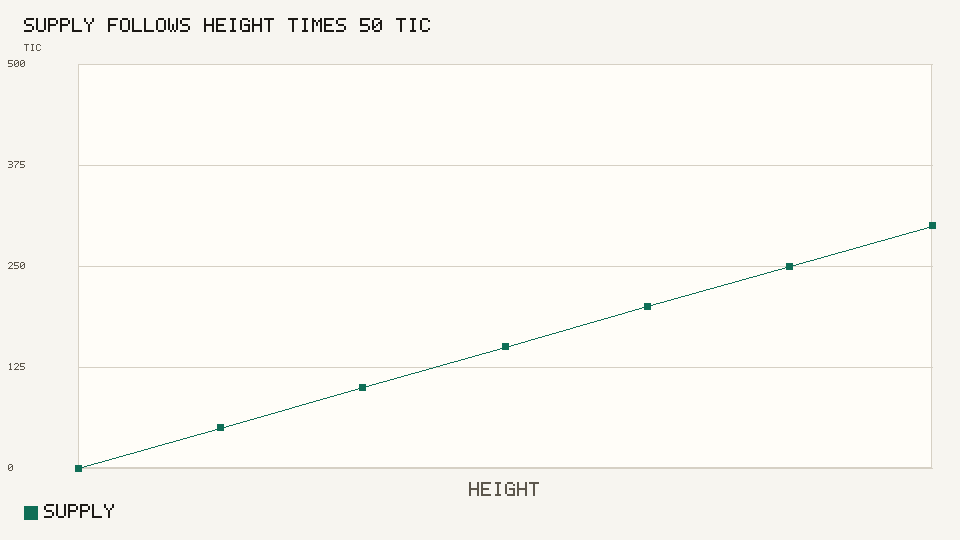

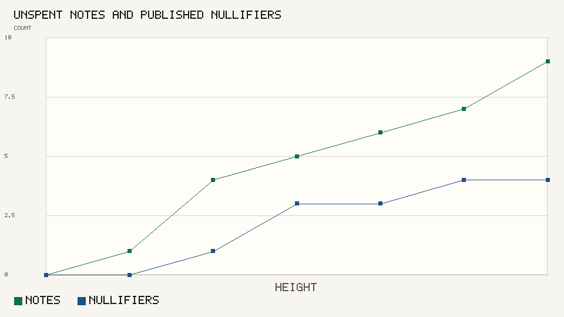

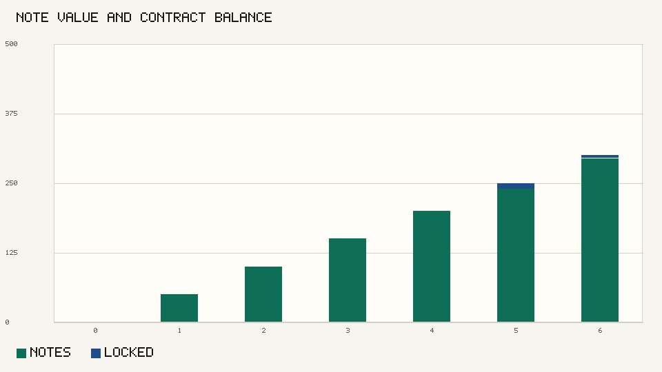

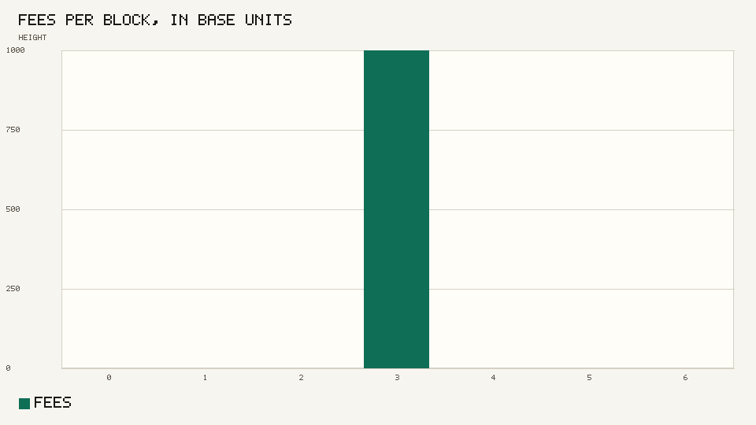

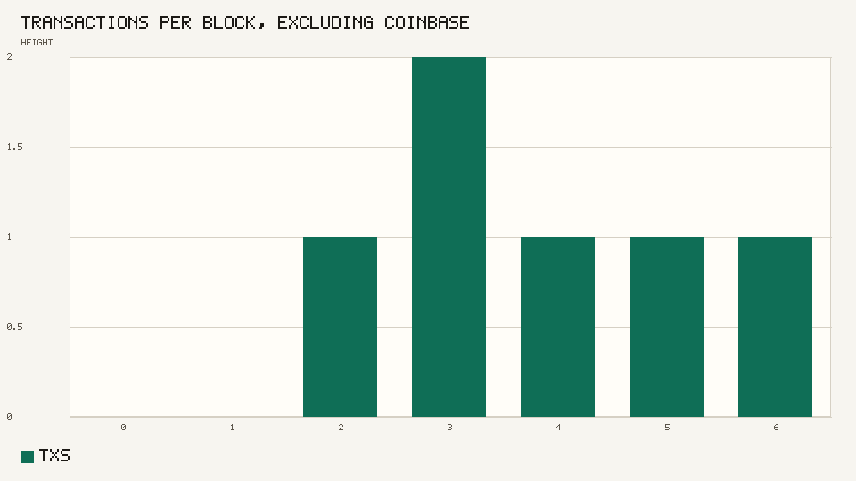

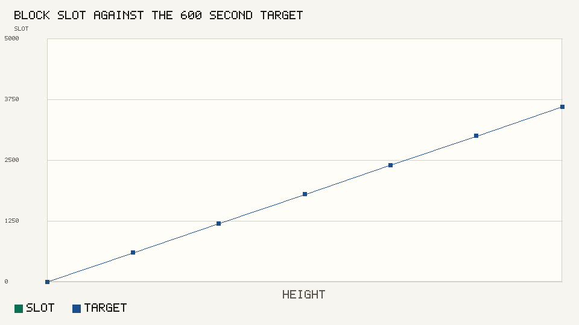

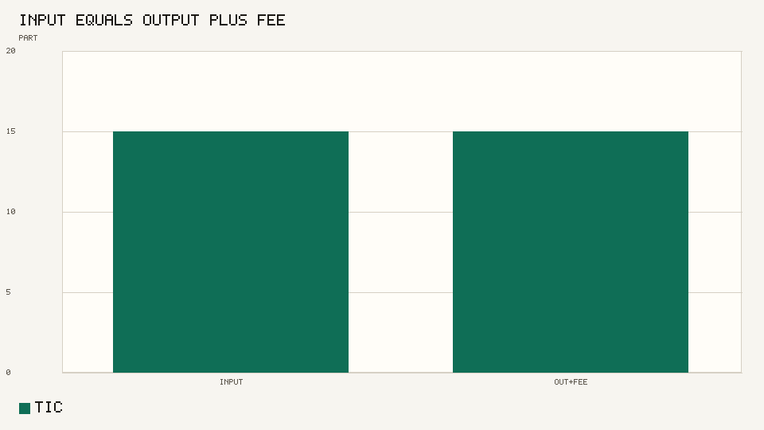

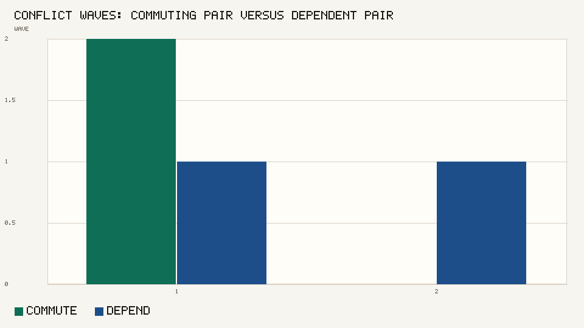

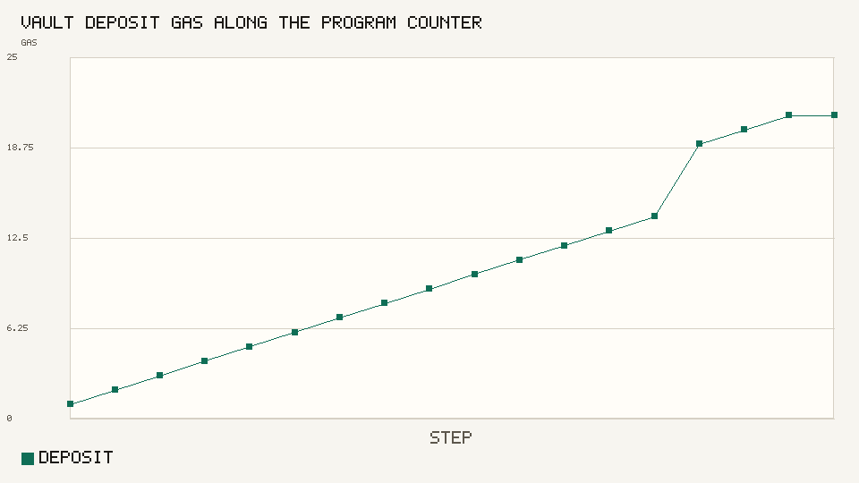

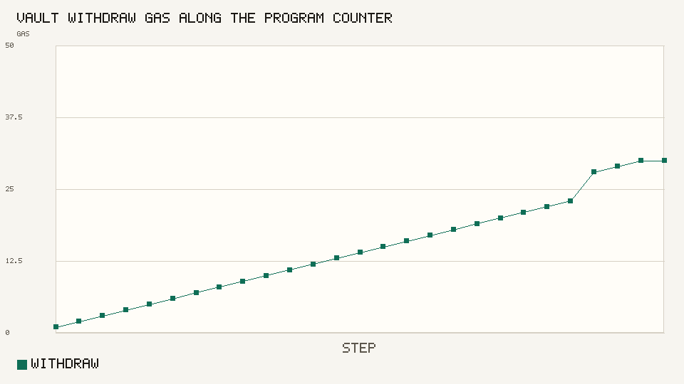

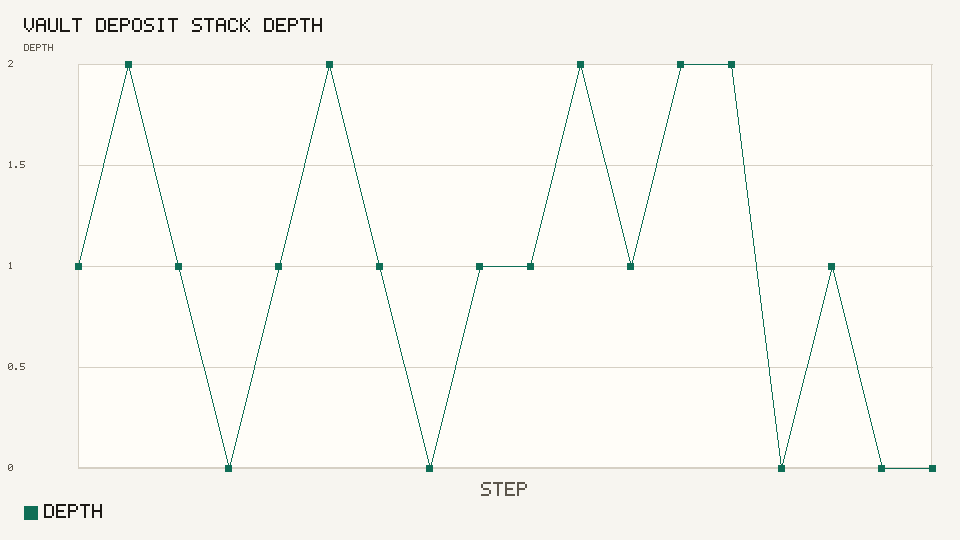

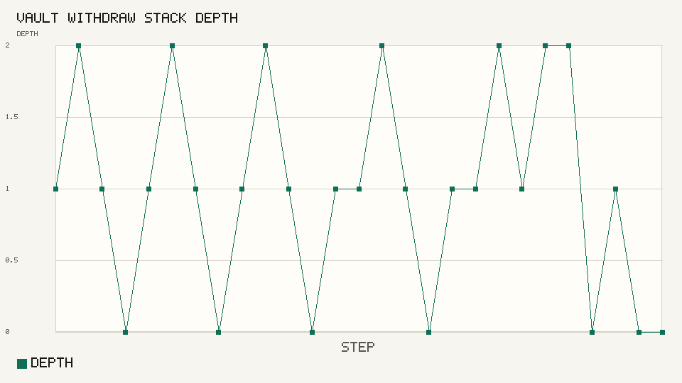

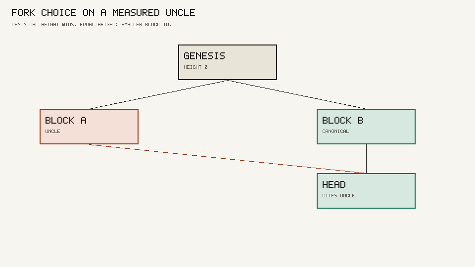

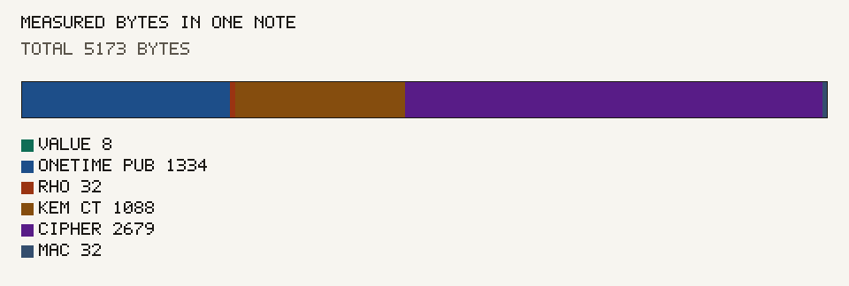

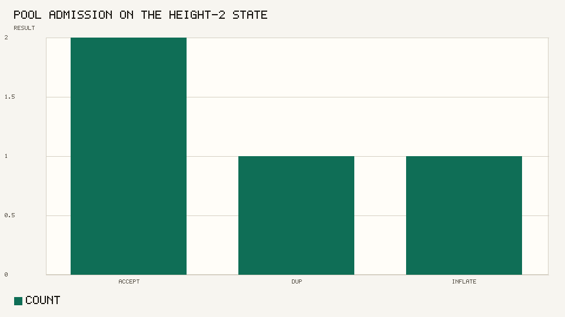

The table behind those files is in [docs/charts/README.md](docs/charts/README.md). The state machine is in [docs/L1.md](docs/L1.md) and [docs/PROTOCOL.md](docs/PROTOCOL.md).

## Run

OpenSSL 3.5 or newer is required.

```bash
cd ~/Timecoin
python3 -m unittest tests.test_timecoin tests.test_l1
python3 -m timecoin.cli demo
python3 -m timecoin.cli charts
```

`charts` rewrites `docs/charts` from a new run of the same scenario. Supply, fees, wave sizes, and the vault balance stay the same. Block ids change because each run generates new keys.
