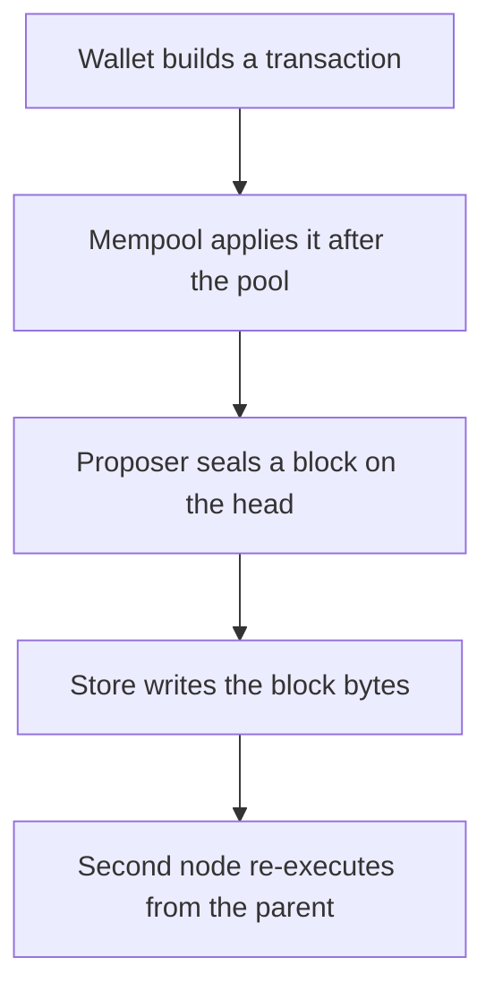
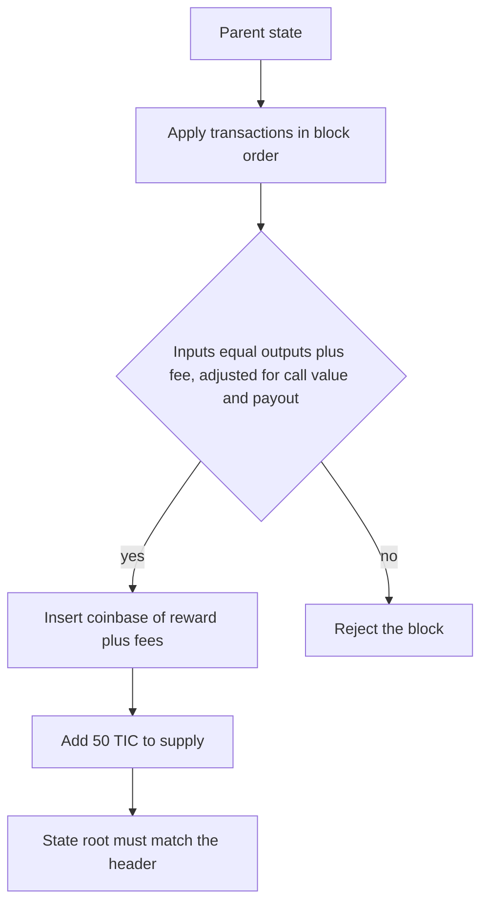
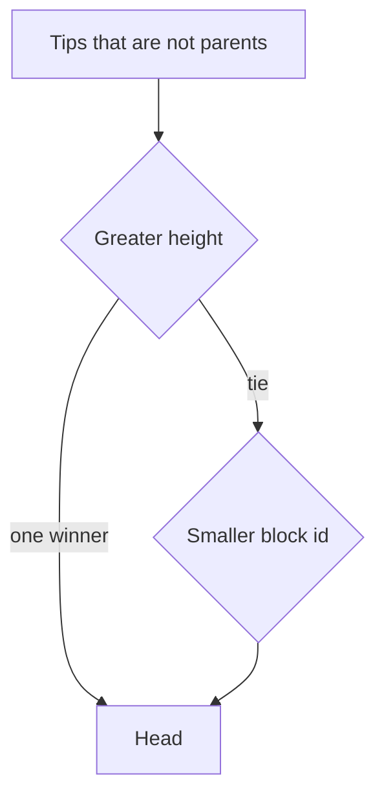
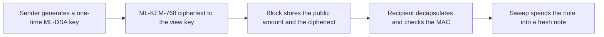

# Layer 1

Timecoin is a single-operator layer-1 testnet. A node checks each block from genesis. Version 0.2.0 has no gossip network and no mainnet parameters. Two processes can still exchange a block: the bytes carry the transactions, the coinbase, and the signatures, and the receiver re-executes them.

Original repository: <https://github.com/9lordisgod/Timecoin>

## Paths

## State transition

Only the reward increases supply. A fee is taken from the inputs and paid to the coinbase. The token is Timecoin and the ticker is TIC.

## Fork choice

An uncle is a block that shares its parent's parent and its parent's height. The child may cite at most two uncles. Uncle transactions are not applied.

## Notes

The long-term view key is not a block field. Amounts stay public so every node can reject inflation without a proof.

## Conflict waves

Transactions that do not share a note commitment, a nullifier, or a contract id commute. Overlapping transactions stay in listed order. The measured run puts two payments in one wave and a spend of a new note in a second wave. See `docs/charts/waves.png`.
